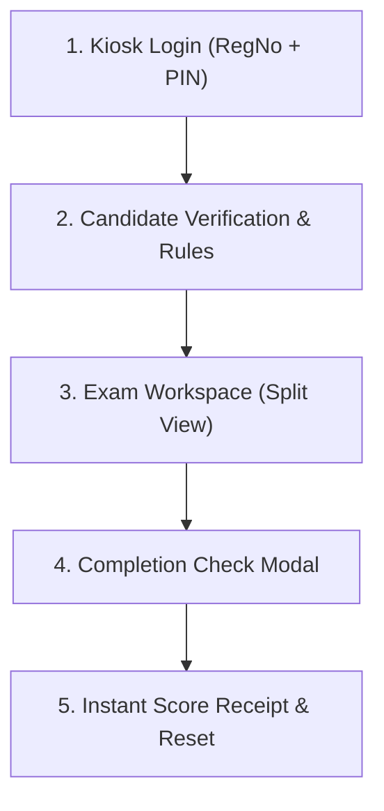

# COTHIGLOBAL Design System (DESIGN.md)

## 1. Overview & Architectural Philosophy

**COTHIGLOBAL** is an enterprise-grade Computer-Based Testing (CBT) and smart school assessment design system developed for Nigerian primary, secondary, and tertiary educational institutions. It powers the central cloud assessment infrastructure at [`cbtbycothi.com.ng`](https://cbtbycothi.com.ng), alongside air-gapped, zero-latency offline exam server applications and lockdown student kiosk terminals.

### Core Architectural Goals:
1. **Zero-Latency Resilience (0ms Local Execution):** In high-stakes examinations (WAEC/NECO/JAMB prep, terminal examinations), students must experience instantaneous question navigation and answer commitment without network spinners or page reloads.
2. **Dual-Environment Harmony:** Visual and behavioral parity between the centralized SaaS cloud (`https://cbtbycothi.com.ng`) and the offline local examination terminal running on local school Wi-Fi or wired Ethernet labs.
3. **Multi-Tenant Authority:** Each institution (e.g., *Excel Royal Academy*, *Christ The Saviour Secondary School*, *Anchor Secondary School*, *Kings Kids Academy*) maintains distinct brand authority (logos, mottos, colors), framed inside a consistent, high-trust COTHIGLOBAL administrative shell.
4. **Distraction-Free Focus:** Eliminates all non-essential visual cognitive loads during testing sessions. Typography, high-contrast answer tiles, and clear color-coded palette buttons prioritize student calm and readability.

---

## 2. Color Palette & Design Tokens

The visual foundation is anchored by COTHIGLOBAL's signature **Royal Blue** (`#2563EB`) and **Dark Slate Navy** (`#222E3C`), complemented by clean daylight neutrals and high-contrast semantic signals.

### 2.1 Brand & Neutral Tokens
| Token Name | Hex Code | Tailwind Equivalent | Role & Application |
| :--- | :--- | :--- | :--- |
| **Primary** | `#2563EB` | `blue-600` | Signature brand color. Primary CTAs, active question borders, verified badges, active selection fills. |
| **Primary Hover** | `#1D4ED8` | `blue-700` | Hover state for primary buttons and interactive controls. |
| **Primary Deep** | `#1E3A8A` | `blue-900` | Header text, gradient start for hero banners, brand theme anchor. |
| **Primary Soft** | `#EFF6FF` | `blue-50` | Background tint for selected answers, active table rows, and question counter pills. |
| **Primary Border** | `#BFDBFE` | `blue-200` | Border for selected answer cards, subtle focus rings. |
| **Sidebar / Chrome**| `#222E3C` | Custom Slate Navy | Top kiosk header, administrative sidebar, lockdown app frame. |
| **Sidebar Active** | `#1E2936` | Custom Dark Slate | Active tab background in supervisor console, selected navigation item. |
| **Sidebar Hover** | `rgba(44,59,76,0.5)`| Custom Slate Tint | Subtle hover state for navigation items. |
| **Sidebar Text** | `#A3B1C2` | Custom Slate Muted| Inactive navigation labels, secondary topbar metadata. |
| **Canvas Background**| `#F8FAFC` | `slate-50` | Default daylight background canvas for exam workspaces and console. |
| **Surface (Card)** | `#FFFFFF` | `white` | Cards, exam workspace panels, modals, answer containers. |
| **Ink (Text Main)** | `#0F172A` | `slate-900` | Question text, headings, student names, high-contrast readable copy. |
| **Ink Muted** | `#64748B` | `slate-500` | Secondary descriptions, timestamps, instructions, unselected options. |
| **Border Outline** | `#E2E8F0` | `slate-200` | Card borders, answer option outlines, table cell dividers. |

### 2.2 Semantic & Status Tokens
| Token Name | Hex Code | Role & Application |
| :--- | :--- | :--- |
| **Gold / Warning** | `#F59E0B` | Flagged questions in navigator, timer borders, supervisor key indicators, pending badges. |
| **Gold Hover** | `#D97706` | Hover state on warning controls and flagged review buttons. |
| **Gold Soft** | `#FEF3C7` | Background tint for flagged questions and supervisor warning notices. |
| **Success** | `#16A34A` / `#10B981` | Answered question buttons, passed examination badges, LAN active status dot. |
| **Success Soft** | `#ECFDF5` / `#DCFCE7` | Answered stat chip background, live cloud connection banner tint. |
| **Danger / Alert** | `#EF4444` / `#DC2626` | Urgent timer (< 5 mins), locked terminal alerts, delete/reset triggers. |
| **Danger Soft** | `#FEF2F2` | Error banner background, invalid PIN alerts. |

### 2.3 Atmospheric Ambient Gradients
- **Kiosk Login Canvas:**
  ```css
  background: radial-gradient(circle at 20% 20%, rgba(99, 102, 241, 0.18) 0%, transparent 40%),
              radial-gradient(circle at 80% 80%, rgba(16, 185, 129, 0.18) 0%, transparent 40%),
              linear-gradient(135deg, #0F172A 0%, #1E1B4B 50%, #064E3B 100%);
  ```
- **Console Cloud Banner:**
  ```css
  background: linear-gradient(135deg, #1E3A8A 0%, #2563EB 100%);
  ```

---

## 3. Typography & Font Hierarchy

COTHIGLOBAL employs a two-tier typography stack paired with tabular monospace numerals for mathematical calculations and timekeeping. All fonts are bundled locally as `.woff2` assets for 100% offline lab operation.

```css
font-family: 'Inter', 'Poppins', -apple-system, BlinkMacSystemFont, "Segoe UI", Roboto, sans-serif;
```

### 3.1 Typefaces
1. **Primary Interface & Body (Inter):**
   - Weights: `400` (Regular), `500` (Medium), `600` (SemiBold), `700` (Bold).
   - Applied to: Question body copy, option text, administrative data tables, dialog instructions, form inputs.
   - Purpose: Tall x-height and distinct apertures maintain maximum legibility across CRT/LCD lab screens.
2. **Display & Headings (Poppins):**
   - Weights: `600` (SemiBold), `700` (Bold), `800` (ExtraBold), `900` (Black).
   - Applied to: School brand titles, login modal headings, score displays, section headers.
   - Purpose: Clean geometric curves that convey modern institutional trust.
3. **Tabular Numerals (JetBrains Mono / ui-monospace):**
   - Applied to: Examination timers (`00:45:20`), Candidate Registration Numbers (`CTSS/2026/042`), Receipt IDs (`SUB-88231`), IP addresses.

### 3.2 Type Scale
| Level | Font Family | Size / Line-Height | Weight | Tracking | Usage |
| :--- | :--- | :--- | :--- | :--- | :--- |
| **Display Score** | Poppins | `48px / 1.0` | `800` | `-0.02em` | Final score badge, submission summary |
| **Header Title** | Poppins | `24px / 1.2` | `800` | `-0.01em` | Screen titles, login card header |
| **Card Heading (H2)**| Poppins | `20px / 1.3` | `700` | `-0.01em` | Section headers, modal dialog titles |
| **Question Body** | Inter | `19px / 1.6` | `600` | `0` | Primary exam question text |
| **Option Text** | Inter | `16px / 1.5` | `500` | `0` | Answer choices A, B, C, D |
| **Standard Body** | Inter | `14px / 1.5` | `400` / `500`| `0` | Instructions, table cells, descriptions |
| **Badge / Label** | Inter | `12px / 1.2` | `700` | `+0.05em` | Status chips, question marks pill |
| **Timer Clock** | Monospace | `22px / 1.0` | `800` | `+0.04em` | Countdown clock |
| **Micro Caption** | Inter | `11px / 1.2` | `600` | `+0.08em` | Copyright, school mottos, timestamps |

---

## 4. Elevation, Radii & Surface Geometry

### 4.1 Radii System
- **Pill (999px):** Status badges, timer containers, question number pills, server connection dots.
- **Large Panels (24px):** Login glassmorphism modal card, biometric verification overview card.
- **Standard Cards (14px):** Question container panel, Question Navigator sidebar, option cards.
- **Controls & Inputs (10px–12px):** Action buttons (Next, Previous, Submit), text fields, palette grid buttons.
- **Micro Chips (6px–8px):** Copy buttons, supervisor exit unlock key.

### 4.2 Elevation Levels
- **Level 0 (Flat):** Daylight canvas (`#F8FAFC`).
- **Level 1 (Subtle):** Default cards, question main workspace, and tables:
  ```css
  border: 1px solid #E2E8F0;
  box-shadow: 0 1px 3px rgba(0, 0, 0, 0.05);
  ```
- **Level 2 (Interactive Hover):** School selector cards, option tiles:
  ```css
  transform: translateY(-2px);
  box-shadow: 0 6px 16px rgba(37, 99, 235, 0.08);
  border-color: #BFDBFE;
  ```
- **Level 3 (Modal / Glassmorphism):** Login card and exit PIN modal:
  ```css
  background: rgba(255, 255, 255, 0.95);
  backdrop-filter: blur(20px);
  border: 1px solid rgba(255, 255, 255, 0.5);
  box-shadow: 0 25px 50px -12px rgba(0, 0, 0, 0.35);
  ```

---

## 5. Screen & Component Specifications



### 5.1 Top Chrome & Branding Bar
- **Dimensions:** Fixed `64px` height, full width.
- **Background:** COTHIGLOBAL Dark Slate Navy (`#222E3C`) with `1px solid rgba(255, 255, 255, 0.1)` border.
- **Left Block:** 
  - School logo housed in a `44px` squircle frame with white boundary.
  - School Name in Poppins Bold (`18px`, White), School Motto in Slate Muted (`12px`, `#93C5FD`).
- **Right Block:**
  - **Server Connection Badge:** Rounded pill displaying green pulse dot (`#10B981`) and host status (`Host: 192.168.1.164:8000`). Clicking opens the manual server IP re-target modal.
  - **Countdown Timer:** `#1E2936` pill with `#F59E0B` border and monospace digits (`00:45:00`). When under 5 minutes remain, shifts to flashing red alert (`#EF4444`).
  - **Supervisor Unlock Key:** Small lock button (`🔒`) triggering supervisor exit PIN modal (`Default: 9999`).

---

### 5.2 Kiosk Login Screen (`viewLogin`)
- **Atmosphere:** Deep ambient mesh canvas (`#0F172A` to `#1E1B4B` to `#064E3B`).
- **Container:** `440px` glassmorphic card centered vertically and horizontally.
- **Header:** Pill badge `COTHIGLOBAL SECURE EXAM TERMINAL` in blue tint.
- **Tenant Badge:** `64px` royal blue squircle with school crest or graduation icon.
- **Form Controls:**
  - Registration Number field with graduation cap icon (`🎓`).
  - Access PIN field with key icon (`🔑`).
  - Primary button: `Authenticate & Access Test →` in `#2563EB` with bold typography.
- **Footer Tagline:** `⚡ Protected by COTHIGLOBAL Secure Exam Engine • 0ms LAN Latency`.

---

### 5.3 Biometric & Exam Verification Screen (`viewVerify`)
- **Container:** `680px` wide daylight card.
- **Candidate Data Grid (2-Column):** Displays Candidate Name, Registration Number, Class/Arm (e.g. `SS 2A`), Subject (`English Language`), Time Limit, and Total Questions.
- **Rules Card:** Light amber box (`#FFFBEB`) outlining rules (no window minimization, auto-saving on option select, instantaneous time expiration).
- **Controls:** Outline button `Cancel & Sign Out` and green CTA `BEGIN EXAMINATION NOW 🚀`.

---

### 5.4 Exam Workspace (`viewExam`)
A responsive 2-column layout dividing the question canvas from the navigation sidebar.

```
+------------------------------------------------------+---------------------+
| Question 1 of 40                      Marks: 2.5 pts | Question Navigator  |
+------------------------------------------------------+ [14 Ans] [26 Pend]  |
|                                                      |                     |
| Which organelle is referred to as the powerhouse of  | [ 1 ][ 2 ][ 3 ][ 4 ]|
| the cell?                                            | [ 5 ][ 6 ][ 7 ][ 8 ]|
|                                                      | [ 9 ][10 ][11 ][12 ]|
| [ A ] Ribosome                                       | [13 ][14 ][15 ][16 ]|
|                                                      |                     |
| [*B*] Mitochondria (Selected - Blue Ring)            |                     |
|                                                      |                     |
| [ C ] Golgi apparatus                                |                     |
|                                                      |                     |
| [ D ] Nucleus                                        | [ Submit Paper  ]   |
+------------------------------------------------------+---------------------+
| [<- Prev]  [Next ->]          [Flag Question] [Finish]                     |
+------------------------------------------------------+---------------------+
```

#### Left: Main Question Panel
- **Top Bar:** Question indicator (`Question 1 of 40` in `19px Bold`) and mark pill (`Marks: 2.5` in `#EFF6FF`).
- **Body Area:** Generous padding (`30px`), clear line-height (`1.6`), supporting rich text and diagrams.
- **Answer Options:** 4 option containers:
  - **Resting:** `2px solid #E2E8F0`, white background.
  - **Hover:** Border shifts to `#93C5FD`, background `#F0F7FF`.
  - **Selected:** Border `#2563EB`, background `#EFF6FF`, letter badge turns filled blue with white text.
- **Bottom Navigation Bar:**
  - `← Previous` (Outline secondary).
  - `Next Question →` (Primary `#2563EB`).
  - `🚩 Flag Question` (Amber outline `#F59E0B`).
  - `✓ Finish & Submit` (Green `#16A34A`).

#### Right: Question Navigator Palette
- **Palette Sidebar:** Sticky `340px` column with white background and `#E2E8F0` border.
- **Summary Pills:** 3 counter chips:
  - `Answered` in blue soft (`#EFF6FF`).
  - `Pending` in slate neutral (`#F1F5F9`).
  - `Flagged` in amber soft (`#FEF3C7`).
- **5-Column Button Grid:**
  - Square `10px` rounded buttons for each question index.
  - White with border for unvisited.
  - Solid Royal Blue (`#2563EB`) for answered.
  - Solid Amber (`#F59E0B`) for flagged.
  - Blue ring (`outline: 2px solid #2563EB`) for current active question.
- **Footer:** Full-width green `Submit Paper` button.

---

### 5.5 Final Confirmation Modal (`modalSubmit`)
- **Backdrop:** `rgba(15, 23, 42, 0.65)` blur overlay preventing interaction.
- **Summary Card:** Big completion stats:
  - Green number: Questions completed.
  - Red number: Questions unanswered.
  - Amber number: Flagged items.
- **Audit Text:** `⚡ Submissions drop into the supervisor console in less than 0.05 seconds.`
- **Actions:** `Return to Exam` (Outline) vs `Yes, Submit Now` (Emerald Solid).

---

### 5.6 Result & Submission Receipt Screen (`viewReceipt`)
- **Icon:** Large animated checkmark (`✅`).
- **Headline:** `Submission Confirmed!`
- **Data Slip:** Timestamped record showing Candidate Name, Reg Number, Subject, and unique submission receipt code (`SUB-XXXX`).
- **Score Card (Optional by School Policy):** Big score display (`72 / 100`, `72% - EXCELLENT`), with grade pill.
- **Action:** Full-width `Exit to Terminal Home` resetting the machine for the next session.

---

## 6. Supervisor Administration Console

The supervisor console provides examiners with local network controls and live cloud sync to `cbtbycothi.com.ng`.

### 6.1 Left Navigation Bar
- Fixed `270px` column in `#222E3C`.
- Navigation items:
  1. `🏫 Select School & Sync` (Cloud download step).
  2. `📡 Live Exam Monitor` (Real-time LAN candidate telemetry).
  3. `✍️ Create Questions` (Local question builder).
  4. `☁️ COTHI School Exams` (Central cloud question bank).
  5. `🎨 School Branding` (Local branding preview).
  6. `🏆 Results & Sync` (Export and cloud upload).
- Server status badge at bottom: `LAN Server Active` with pulsating emerald LED.

### 6.2 Cloud Synchronization Interface
- **Online Initialization Banner:** Explains the 30-second hotspot sync procedure:
  > *"When you arrive at a school, connect to mobile data/hotspot for 30 seconds. Click 'Refresh Live from COTHI Cloud' to fetch branding, student rosters, and questions. Then disconnect internet and administer the exam 100% offline!"*
- **Live Status Feedback:**
  - Green Banner: `✅ Successfully Connected to COTHIGLOBAL Cloud (cbtbycothi.com.ng)! Downloaded latest registry.`
  - Amber Banner: `⚠️ Offline Mode: Showing registered schools from local cache.`
- **School Cards Grid:** Card for each registered institution displaying school code tag, motto, registered candidate counter, and one-click `⬇️ Download & Activate All Data for This School` button.

---

## 7. Motion, Feedback & Interactive Micro-Moments

- **Instant Auto-Save:** When an answer option is clicked, the selection is written into local state and localStorage in `0ms`. The option container scales slightly (`0.99` snap) with zero lag.
- **Card Hover:** Standard interactive cards utilize `transform: translateY(-2px)` and transition over `150ms ease-out`.
- **Button Press:** Active state applies `transform: scale(0.98)` for tactile mechanical feedback.
- **Timer Urgent State:** When countdown drops below `00:05:00`, the timer box pulses a gentle red border transition over `1000ms infinite`.
- **Exam Submission Drop:** The supervisor live monitor receives submissions via SSE (Server-Sent Events) within `50ms`, triggering a slide-down banner notification on the supervisor console.

---

## 8. Offline Resilience & Air-Gapped Rules

1. **No CDN Dependency:** All JavaScript, stylesheets, SVG icons, and `.woff2` font files are packaged inside the Electron `.asar` bundles. Disconnecting the internet never breaks styling or typography.
2. **Local Port Integrity:**
   - Server HTTP runs on port `8000` (all network interfaces `0.0.0.0`).
   - UDP Auto-Discovery beacon broadcasts on port `8001` every 3 seconds.
   - Student Kiosk automatically discovers the supervisor IP over Wi-Fi without manual IP typing.
3. **Graceful Fallbacks:** If the supervisor PC is offline, school activation reads from `data/cothi_cache.json`.
4. **Cloud Submission Queue:** Student answers are preserved in local JSON storage (`data/submissions.json`). The supervisor can sync all batches to `https://cbtbycothi.com.ng/api/v1/sync` once internet is re-established.

---

## 9. Do's and Don'ts

### Do's:
- **Do** maintain `#2563EB` as the primary brand color across all primary buttons and active indicators.
- **Do** keep `#222E3C` for dark navigation chrome, topbars, and sidebar surfaces.
- **Do** use `Inter` for all question copy and `Poppins` for titles and school names.
- **Do** ensure font sizes for question text are at least `18px` with `1.6` line-height.
- **Do** preserve the 2-column workspace layout with the sticky Question Navigator palette.
- **Do** test all screens without an active internet connection to ensure offline font and style persistence.

### Don'ts:
- **Don't** use arbitrary green (`#0b6b3a`) as the primary brand color — green is reserved strictly for *Success / Answered* states.
- **Don't** introduce blocking network loaders during examination question navigation.
- **Don't** use external Google Fonts `<link>` tags without bundled local `@font-face` fallbacks.
- **Don't** hide the remaining exam time; keep the clock visible in the header at all times.
- **Don't** allow candidates to exit kiosk mode without the master supervisor PIN (`9999`).
